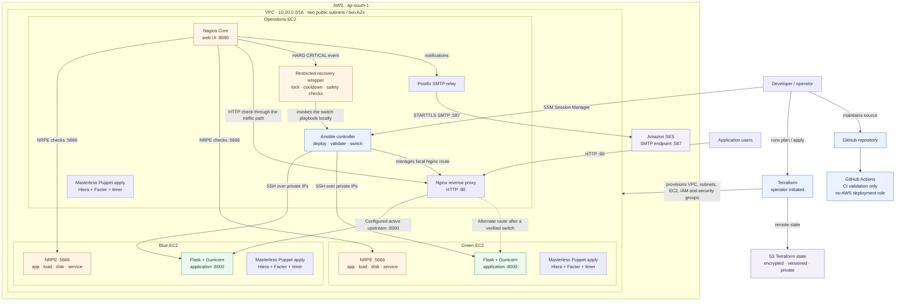
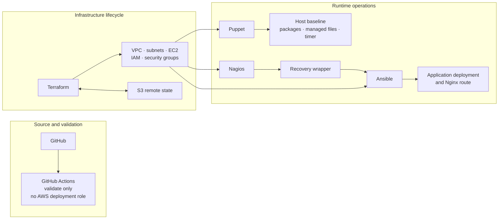
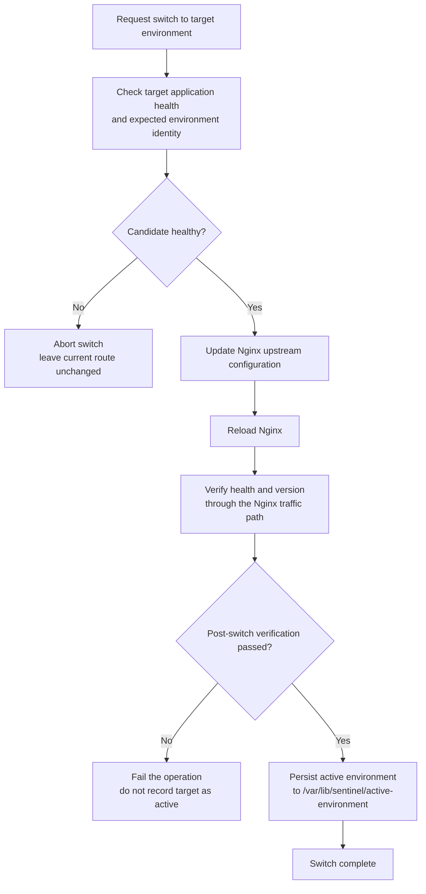
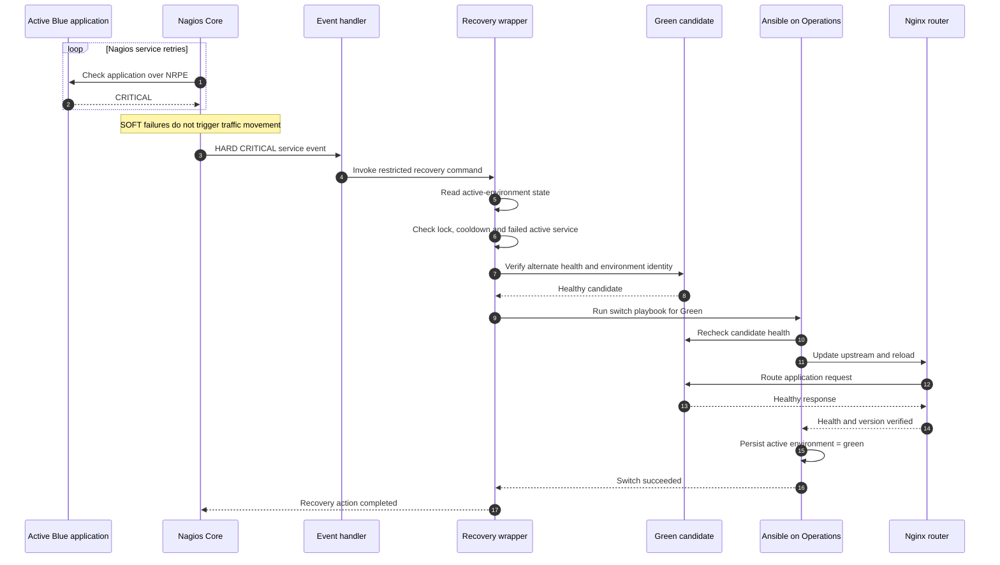

# AEGIS — A production-inspired journey close to heart, fueled by my burning passion for DevOps.

### Self-Healing Blue–Green Deployment Platform on AWS

**Deploy deliberately. Route safely. Detect failure. Recover automatically.**

AEGIS is an AWS-hosted platform that brings infrastructure provisioning, controlled Blue–Green releases, configuration enforcement, continuous monitoring, and bounded automatic recovery into one observable system.

Its defining feature is not simply that it can switch between two application environments. It is that the switch is guarded by health checks, recorded as operational state, and can be initiated by the monitoring system when the active application fails.

> **The operating rule:** an environment does not receive production traffic merely because it exists. It must prove that it is healthy before it is promoted.

---

## Table of contents

- [At a glance](#at-a-glance)
- [Why AEGIS is designed this way](#why-aegis-is-designed-this-way)
- [Architecture](#architecture)
- [The traffic-switching contract](#the-traffic-switching-contract)
- [Automatic recovery: the closed loop](#automatic-recovery-the-closed-loop)
- [What each component owns](#what-each-component-owns)
- [Implementation details](#implementation-details)
- [Repository layout](#repository-layout)
- [Operational walkthrough](#operational-walkthrough)
- [Validation and demonstrated results](#validation-and-demonstrated-results)
- [Security and operational boundaries](#security-and-operational-boundaries)
- [Known limitations](#known-limitations)
- [Future engineering work](#future-engineering-work)
- [Documentation](#documentation)

---

## At a glance

| Area | Implementation |
|---|---|
| Cloud | AWS, `ap-south-1` (Mumbai) |
| Compute | Three Ubuntu 22.04 EC2 instances |
| Network | VPC `10.20.0.0/16`, two public subnets across two Availability Zones |
| Traffic entry | Nginx reverse proxy on the Operations node, HTTP port `80` |
| Application | Flask served by Gunicorn on port `8000` |
| Deployment and orchestration | Ansible |
| Infrastructure as Code | Terraform, remote state in S3 |
| Configuration enforcement | Puppet Core 9, masterless; Hiera v5 and external Facter facts |
| Monitoring | Nagios Core 4.5.14, NRPE and a custom application health plugin |
| Notifications | Postfix relay through Amazon SES SMTP |
| CI | GitHub Actions validation workflow; no AWS deployment credentials |

### The three-node model

| Node | Responsibility |
|---|---|
| **Operations** | Nginx traffic entry point, Ansible controller, Nagios Core, recovery wrapper and notification relay |
| **Blue** | Flask/Gunicorn application environment and NRPE monitoring agent |
| **Green** | Flask/Gunicorn application environment and NRPE monitoring agent |

The application environments are kept separate from the traffic-control and monitoring functions. Nginx sends application traffic to one configured upstream at a time; the other environment is the candidate for a later promotion or recovery switch.

---

## Why AEGIS is designed this way

A Blue–Green deployment is only useful when the transition between environments is controlled. AEGIS is built around a few deliberate architectural decisions.

### 1. Separate the application from the traffic decision

Blue and Green run the application independently. Nginx on the Operations node is the explicit traffic-control point. A release can be present on an environment without that environment receiving live requests.

**Why it matters:** deployment and promotion are different operations. A candidate can be prepared and checked before the active route changes.

### 2. Make health a precondition for promotion

The Ansible switch playbook checks the candidate environment before changing Nginx. If the candidate is unhealthy, the playbook stops before changing the active route. After the route change, it verifies the application through Nginx before recording the new active environment.

**Why it matters:** a successful configuration edit is not the same as a successful traffic switch. The user-facing path must work after the change.

### 3. Let monitoring initiate recovery, but not make the routing decision itself

Nagios detects and classifies the failure. A restricted event handler invokes a local recovery wrapper. The wrapper checks the current active environment, verifies that the alternate is suitable, and then delegates the actual switch to the same Ansible playbook used for controlled traffic changes.

**Why it matters:** manual and automatic switching share one implementation of the routing procedure. Recovery does not maintain a second, divergent way of changing Nginx.

### 4. Trigger recovery on a confirmed failure, not a transient result

The recovery handler acts on a **HARD CRITICAL** service state, after Nagios has exhausted its configured SOFT retries. It also checks the active-environment state, candidate health, a lock and a cooldown before proceeding.

**Why it matters:** a single failed probe should not cause a traffic move. The recovery path is deliberately bounded to reduce unnecessary or repeated failovers.

### 5. Give configuration ownership clear boundaries

Puppet enforces the common host baseline. Ansible manages application deployment and Nginx routing. Nagios owns monitoring and event-handler configuration. These tools are not allowed to compete for the same application and routing files.

**Why it matters:** configuration management becomes unreliable when two controllers continuously overwrite one another's resources.

### 6. Keep CI separate from production access

GitHub Actions validates repository content. It does not currently assume an AWS role, connect to EC2, or deploy releases.

**Why it matters:** useful continuous integration can be introduced without immediately granting a hosted runner production credentials. Deployment remains an explicit Ansible operation.

---

## Architecture

The diagrams below are expressed in Mermaid so that the source remains reviewable alongside the implementation. GitHub renders them directly in this README.

### Platform topology



**Reading the traffic arrows:** the solid Blue connection represents the example active route. The dashed Green connection represents the alternate route available to the switch procedure; it is not a claim that both environments receive traffic simultaneously. The configured Nginx upstream points to one environment at a time.

### Responsibility and trust boundaries



The control boundaries are intentional: Terraform creates the infrastructure; Ansible operates releases and traffic; Puppet continuously enforces the host baseline; Nagios observes service state and requests a controlled recovery. CI validates code but is not part of the production control path.

---

## The traffic-switching contract

The switch is treated as a guarded transaction, not a blind edit to an Nginx upstream file.



The playbook's essential safeguards are:

1. **Precondition:** the target must answer the application health check and identify itself as the expected environment.
2. **Route change:** Nginx is changed only after the candidate passes the precondition.
3. **Postcondition:** the application is checked through the Nginx path after reload.
4. **State record:** `/var/lib/sentinel/active-environment` is updated only after successful route verification.

This gives the recovery wrapper a durable answer to a critical question: *which environment is currently receiving traffic?*

---

## Automatic recovery: the closed loop

AEGIS connects monitoring to a controlled action. Nagios does not directly edit Nginx. It invokes a restricted local handler, which calls the same Ansible switch procedure used by an operator.



### Recovery safeguards

- **HARD-state gate:** recovery is requested only after Nagios reaches a HARD CRITICAL state, not on the first SOFT failure.
- **Active-slot check:** the wrapper confirms that the failed service belongs to the currently active environment.
- **Standby validation:** the alternate environment must pass health and environment-identity checks before promotion.
- **Concurrency protection:** a lock prevents overlapping recovery actions.
- **Cooldown:** a five-minute cooldown prevents repeated automated switches in rapid succession.
- **Post-switch verification:** the route and application health are checked after Nginx reload.
- **Restricted privilege:** Nagios is allowed to invoke the specific recovery command through a dedicated sudoers rule, rather than receiving unrestricted administrative access.

**Important distinction:** this is traffic failover to an already-running alternate environment. It is not an automatic rollback to an earlier application artifact or release version.

---

## What each component owns

| Component | Owns | Deliberately does not own |
|---|---|---|
| Terraform | VPC, subnets, internet gateway, EC2, instance profile, security groups and S3-backed state | Application release contents or Nginx route decisions |
| Ansible | Host bootstrap, application deployment, NRPE setup, Puppet setup and traffic switching | Continuous host-baseline enforcement or Nagios state evaluation |
| Puppet | Common package/configuration baseline, role-specific values and scheduled masterless enforcement | Flask/Gunicorn releases, Nginx routing, NRPE configuration, Nagios objects or recovery scripts |
| Nagios | Host/service checks, notifications and event-handler trigger | Direct application deployment or direct Nginx configuration edits |
| Nginx | HTTP entry point and the currently configured application upstream | Health-based promotion policy; Ansible performs the guarded switch |
| GitHub Actions | Repository-level CI validation | AWS provisioning or production deployment |

This ownership model is one of the most important design choices in AEGIS. Each tool has a defined control surface, which reduces configuration drift caused by competing automation.

---

## Implementation details

### Infrastructure layer — Terraform

Terraform provisions the AWS foundation in Mumbai:

- VPC CIDR: `10.20.0.0/16`.
- Two public subnets distributed across two Availability Zones.
- Internet gateway and routing for the public subnets.
- Three Ubuntu 22.04 EC2 instances: Operations, Blue and Green.
- An EC2 instance role and instance profile with Systems Manager access.
- Security groups that restrict application, monitoring and administration paths.
- An S3 backend for the main Terraform state, with bucket versioning, server-side encryption, public-access blocking and a TLS-only bucket policy. State locking uses the S3 lock-file mechanism.

The bootstrap state-bucket configuration is maintained separately from the main infrastructure configuration. Backend configuration containing environment-specific values is supplied locally rather than committed.

### Application and traffic layer — Flask, Gunicorn and Nginx

- The application is a Flask service served by Gunicorn on port `8000` on each application environment.
- `/health` provides the application health response.
- `/version` exposes the running application version and environment identity used during validation.
- Nginx runs on the Operations node and accepts application traffic on port `80`.
- `/nginx-health` is used to check the Nginx layer itself.
- Ansible manages the upstream configuration, reload and end-to-end verification.

The health model checks more than whether a TCP port is open: the custom check validates the HTTP response, healthy status, expected environment and a non-empty version.

### Configuration layer — Puppet, Hiera and Facter

Puppet runs in **masterless mode** on all three nodes; there is no Puppet Server in this design.

- Puppet Core 9.1.4 is installed on the nodes.
- External Facter facts identify each node's role: `operations`, `blue` or `green`.
- Hiera v5 loads shared defaults from `common.yaml` and role-specific values from `operations.yaml`, `blue.yaml` or `green.yaml`.
- The `sentinel_baseline` module uses EPP templates to render managed configuration and the systemd apply service/timer.
- A systemd timer schedules recurring Puppet enforcement.

The role-specific baseline distinguishes the Operations host from the two application hosts. The purpose of Puppet here is to keep a small, predictable host baseline consistent—not to take ownership of the application deployment or traffic-routing layer.

### Monitoring and recovery layer — Nagios, NRPE and custom checks

- Nagios Core 4.5.14 runs on Operations. Its web interface is exposed on port `8080`.
- NRPE runs on Blue and Green and listens on port `5666`; access is restricted to the Operations security group.
- Custom checks cover the application, Gunicorn service, load and disk.
- A custom Python application plugin validates the health endpoint and expected environment identity.
- The `Active Application Through Nginx` check validates the application through the actual traffic entry point.
- A Nagios event handler invokes `/usr/local/sbin/sentinel-recover` for eligible HARD CRITICAL events.
- Recovery activity is recorded in `/var/log/sentinel-recovery.log` and Nagios state changes are recorded in `/usr/local/nagios/var/nagios.log`.

### Notifications — Postfix and Amazon SES

Nagios notifications are sent from the Operations node through Postfix, which relays outbound email through the Amazon SES SMTP endpoint using STARTTLS on port `587`. SMTP credentials and recipient configuration are kept outside the repository.

### Continuous integration — GitHub Actions

The GitHub Actions workflow runs repository-level validation when code changes. It checks the application and infrastructure/configuration artifacts without provisioning AWS resources or deploying to the EC2 instances.

The workflow uses no AWS access key, OIDC role, or production deployment permission. This is intentionally **CI, not continuous deployment**.

---

## Repository layout

```text
.
├── .github/
│   └── workflows/
│       └── ci.yml                 # Repository validation workflow
├── ansible/                       # Host configuration, deployment and switching
│   ├── inventory/
│   │   └── hosts.ini.example      # Safe inventory template
│   ├── playbooks/                 # Deployment, NRPE, Puppet and switch workflows
│   └── roles/                     # Reusable Ansible roles
├── application/                   # Flask application and tests
├── infrastructure/                # Terraform AWS infrastructure and state bootstrap
├── nagios/                        # Nagios objects, checks and recovery integration
├── puppet/                        # Hiera data, manifests, module and EPP templates
├── scripts/                       # Supporting operational scripts
├── .gitignore
└── readme.md
```

The exact contents of subdirectories may evolve as the project is extended. The live Ansible inventory (`hosts.ini`), Terraform variable files, backend configuration, state files, private keys and service credentials are intentionally excluded from version control.

---

## Operational walkthrough

This section describes the intended order of operations. Use the environment-specific values in your local configuration; do not commit credentials or state files to follow these steps.

### 1. Provision the state backend and infrastructure

Create the S3 state bucket from the bootstrap configuration first. Then initialize the main Terraform configuration with its local backend configuration.

```bash
# Bootstrap the remote-state bucket
terraform -chdir=infrastructure/bootstrap-state init
terraform -chdir=infrastructure/bootstrap-state plan
terraform -chdir=infrastructure/bootstrap-state apply

# Initialize and validate the main infrastructure
terraform -chdir=infrastructure init -backend-config=backend.hcl
terraform -chdir=infrastructure fmt -check -recursive
terraform -chdir=infrastructure validate
terraform -chdir=infrastructure plan
```

Review the plan before applying it. The main backend configuration is local and should not be committed.

### 2. Prepare Ansible access

- Create the runtime inventory from `ansible/inventory/hosts.ini.example`.
- Use the current private IP addresses of the three instances.
- Keep the Ansible private key on the Operations node; do not put it in Git.
- Connect to the Operations node through AWS Systems Manager Session Manager.
- Activate the Ansible virtual environment and verify connectivity before running playbooks.

### 3. Deploy or switch an application environment

Traffic switching is performed from the Ansible controller on Operations. From the repository's `ansible/` directory, for example, route traffic to Green after it is ready:

```bash
cd ansible
ansible-playbook playbooks/switch.yml -e target_environment=green
```

To switch back to Blue:

```bash
ansible-playbook playbooks/switch.yml -e target_environment=blue
```

The playbook validates the target before changing the route and verifies the application through Nginx afterward. A failed candidate check should leave the current route in place.

### 4. Inspect the live route and application

From a host that can reach the Operations traffic endpoint:

```bash
curl -fsS http://<operations-endpoint>/nginx-health
curl -fsS http://<operations-endpoint>/health
curl -fsS http://<operations-endpoint>/version
```

The Nginx health endpoint checks the proxy layer. The application endpoints confirm which environment is serving traffic and which version is running.

### 5. Inspect monitoring and recovery

The Nagios web interface is served by Apache on Operations port `8080` and is restricted to the configured administrator source range.

Useful Operations-node commands:

```bash
# Current active environment
sudo cat /var/lib/sentinel/active-environment

# Automatic recovery activity
sudo tail -f /var/log/sentinel-recovery.log

# Nagios state transitions and event-handler activity
sudo tail -f /usr/local/nagios/var/nagios.log
```

### 6. Inspect Puppet enforcement

```bash
# Check the scheduled enforcement timer
sudo systemctl status sentinel-puppet-apply.timer

# Inspect the rendered baseline
sudo cat /etc/sentinel/puppet-baseline.conf
```

The baseline should contain the node-specific role (`operations`, `application-blue` or `application-green`) and shared project settings.

---

## Validation and demonstrated results

The platform has been exercised beyond a successful first deployment. The following behaviours have been demonstrated during implementation.

| Test | Observed result |
|---|---|
| Initial Ansible deployment | Application and supporting configuration deployed to Operations, Blue and Green without failed tasks. |
| Manual Blue → Green switch | Nginx route changed and the application was verified through the proxy. |
| Manual Green → Blue switch | Reverse switch completed and the active application was verified. |
| Unhealthy candidate rejection | A stopped candidate application failed the health gate; the switch aborted before changing the active route. |
| Puppet role resolution | Facter and Hiera resolved the Operations, Blue and Green roles to their expected values. |
| Puppet baseline enforcement | The baseline was rendered and verified on all three nodes; the scheduled enforcement timer was enabled. |
| Nagios application failure detection | The active Blue application service failure progressed through SOFT failures to a HARD CRITICAL state. |
| Automatic traffic failover | On the HARD CRITICAL event, the recovery wrapper selected healthy Green, Ansible switched the route, and the Nginx application check recovered. |
| Email notification | Nagios notification email was delivered through Postfix and Amazon SES. |
| GitHub CI | A GitHub Actions workflow was added for repository validation without AWS deployment credentials. |

### The recovery test that matters

The key end-to-end test deliberately stopped the `sentinel-app` systemd service on Blue while leaving the EC2 instance and NRPE agent running. Nagios recorded the application service as CRITICAL on SOFT attempts 1 and 2. Those events did not move traffic. On HARD attempt 3, the event handler invoked the recovery wrapper. The wrapper confirmed that Blue was the active environment and that Green was healthy, then invoked the Ansible switch procedure. The recovery log recorded success after the Nginx route and application health/version checks passed. The `Active Application Through Nginx` service subsequently returned to OK.

This test demonstrates **application-service-level failover between healthy EC2 instances**. It does not demonstrate recovery from an Operations-node outage, an Availability Zone outage, or a complete EC2 instance failure.

---

## Security and operational boundaries

The repository is designed to contain code and safe examples, not runtime credentials.

- Use AWS Systems Manager Session Manager for operator access to the instances.
- Restrict application and NRPE ports to the required security-group paths. NRPE `5666` and application `8000` are intended for Operations-to-application-node communication, not unrestricted public access.
- Restrict the Nagios interface on `8080` to the administrator source range.
- Keep the Ansible private key on the Operations node and outside Git.
- Keep `hosts.ini`, `.tfvars`, `backend.hcl`, Terraform state, SMTP credentials and Puppet Forge credentials out of Git.
- Store the Puppet Forge API key in the shell environment when required; do not commit it to a file.
- Keep SMTP credentials in root-protected configuration on Operations.
- Review Terraform plans and IAM changes before applying them.
- Treat the Operations node as privileged infrastructure: it holds deployment, monitoring and recovery capabilities.

Before using the platform beyond a controlled project environment, review IAM permissions for least privilege, rotate credentials that were used during development, and verify all security-group rules against the actual deployment requirements.

---

## Known limitations

AEGIS is a working, production-inspired engineering platform, not a claim of production-grade high availability.

1. **Operations is a single point of failure.** Nginx, Ansible, Nagios and the recovery wrapper reside on one EC2 instance. If it becomes unavailable, the current ingress, monitoring and automated recovery path are affected.
2. **The tested recovery scope is application-service failure.** The demonstrated test leaves the host and NRPE agent available. Whole-instance or Availability Zone failure recovery has not been established.
3. **The traffic entry point is a single Nginx instance.** There is no Application Load Balancer or redundant proxy tier in the current topology.
4. **The application nodes are provisioned in public subnets.** Security groups constrain service access, but a hardened production topology would normally move application nodes into private subnets and use suitable private connectivity.
5. **The alternate environment must already be provisioned and healthy.** The recovery path switches traffic; it does not create replacement capacity.
6. **Recovery is not artifact rollback.** It promotes the alternate environment. It does not automatically restore a previous application release on the failed environment.
7. **Continuous deployment is not enabled.** GitHub Actions validates source changes; releases are still orchestrated through Ansible.
8. **Email delivery depends on SES configuration.** Sender/recipient verification, account mode and SMTP credentials must be maintained separately.

These limitations are explicit design boundaries and define the next engineering increments.

---

## Future engineering work

The next steps should strengthen the control plane and reduce infrastructure single points of failure without weakening the current safety checks.

### 1. GitHub Actions → AWS through OIDC

Introduce keyless CI/CD authentication using GitHub Actions OIDC and a dedicated, narrowly scoped AWS IAM role.

A future deployment workflow should:

- Trust only the intended GitHub organization/repository and protected deployment branch or environment.
- Request short-lived AWS credentials through OIDC rather than storing long-lived AWS access keys in GitHub Secrets.
- Restrict permissions to the required deployment operation, preferably invoking a controlled SSM command on Operations rather than granting broad EC2 or IAM permissions.
- Require CI success and an environment approval before production deployment.
- Record the commit, artifact version, target slot and deployment result.
- Keep the existing Ansible health gate and post-switch verification as the authority for traffic promotion.

**This is future work.** The current workflow does not configure an OIDC provider, assume an AWS role, or deploy to EC2.

### 2. Remove the Operations single point of failure

Move the public traffic entry point to an AWS Application Load Balancer or introduce a redundant routing tier. Separate monitoring/recovery responsibilities from the sole ingress node and define how the control plane behaves if Operations is unavailable.

### 3. Harden the network topology

Move application instances to private subnets, minimize public ingress, and use VPC endpoints or a controlled outbound path for Systems Manager and other required AWS services.

### 4. Extend failure coverage

Test and design recovery for EC2 instance loss, failed NRPE communication, unhealthy standby environments, router failure and Availability Zone disruption. Define which failures should cause traffic failover and which should raise an alert without attempting a switch.

### 5. Strengthen release lifecycle management

Add immutable, versioned application artifacts, deployment history, an explicit promotion/approval stage, and a tested artifact rollback strategy. Keep traffic switching separate from artifact creation.

### 6. Improve operational visibility

Centralize logs and metrics, retain deployment and recovery audit events, and add dashboards for active environment, release version, recovery frequency and health history.

---

## Documentation

- [Terraform documentation](https://developer.hashicorp.com/terraform/docs)
- [Ansible documentation](https://docs.ansible.com/)
- [Puppet documentation](https://help.puppet.com/)
- [Nagios Core documentation](https://www.nagios.org/documentation/)
- [AWS Systems Manager Session Manager](https://docs.aws.amazon.com/systems-manager/latest/userguide/session-manager.html)
- [GitHub Actions documentation](https://docs.github.com/actions)
- [GitHub Actions OIDC with AWS](https://docs.github.com/actions/deployment/security-hardening-your-deployments/configuring-openid-connect-in-amazon-web-services) — future implementation reference

---

<p align="center">
  <strong>AEGIS</strong><br/>
  <em>A deployment is not complete when a release is copied. It is complete when the route is verified, the system is observable, and recovery has a safe path.</em>
</p>
